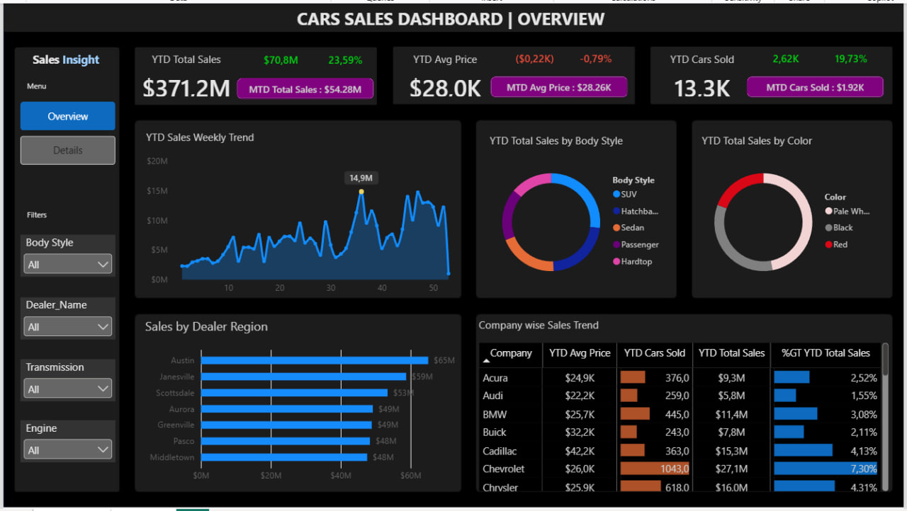
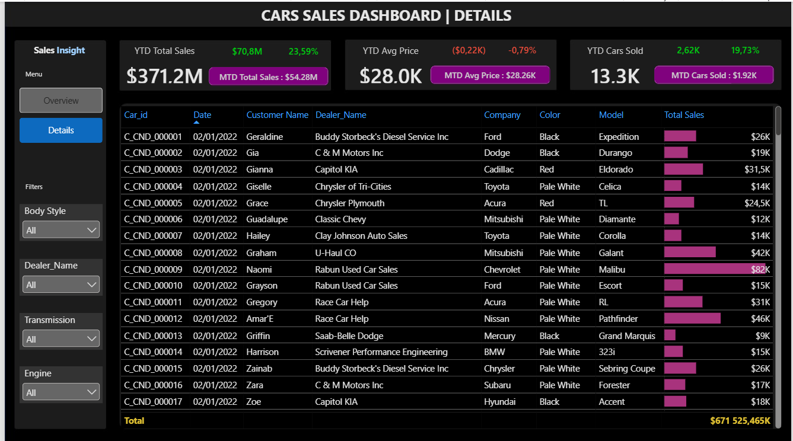

# 🚗 Car Sales Dashboard | Power BI

## 📊 Project Overview

This project is an interactive **Car Sales Dashboard** developed using Microsoft Power BI. It provides a comprehensive analysis of automotive sales performance, helping users monitor key performance indicators, identify sales trends, and compare sales across different regions, companies, and vehicle categories.

The dashboard consists of two interactive pages:

1. **Overview Dashboard** — Sales performance, KPIs, trends, and regional analysis.
2. **Details Dashboard** — Detailed vehicle sales transactions and customer information.

## 🛠️ Tools & Technologies

- **Power BI Desktop** — Dashboard development and data visualization
- **Power Query** — Data cleaning and transformation
- **DAX** — KPI calculations and sales measures
- **Git & GitHub** — Version control and project management

## 📈 Key Performance Indicators (KPIs)

| KPI | Value |
|---|---|
| YTD Total Sales | $371.2M |
| YTD Average Price | $28.0K |
| YTD Cars Sold | 13.3K |
| MTD Total Sales | $54.28M |
| MTD Average Price | $28.26K |
| YTD Sales Growth | 23.59% |
| YTD Cars Sold Growth | 19.73% |

---

## 📊 Dashboard 1 — Sales Overview



The Overview Dashboard provides a summary of car sales performance through interactive visualizations.

### Features

- **YTD Sales Weekly Trend:** Tracks weekly sales fluctuations.
- **Sales by Body Style:** Compares SUV, Hatchback, Sedan, Passenger, and Hardtop categories.
- **Sales by Color:** Analyzes sales across different vehicle colors.
- **Sales by Dealer Region:** Compares sales performance across dealer locations.
- **Company-wise Sales Analysis:** Displays sales revenue, average prices, and vehicles sold by company.
- **Interactive Filters:** Body Style, Dealer Name, Transmission, and Engine.

### Key Insights

- Total year-to-date sales reached **$371.2 million**.
- Approximately **13.3K vehicles** were sold.
- The average selling price was **$28.0K**.
- Austin recorded the highest displayed regional sales at approximately **$65M**.
- Chevrolet generated approximately **$27.1M** in sales.

---

## 📋 Dashboard 2 — Sales Details



The Details Dashboard provides transaction-level information for a more detailed analysis of car sales.

### Features

- Individual car sales records
- Transaction dates and vehicle IDs
- Customer and dealer information
- Vehicle company, model, and color
- Sales amount for each transaction
- Interactive filters for detailed exploration

### Available Data Fields

| Column | Description |
|---|---|
| Car_id | Unique vehicle transaction identifier |
| Date | Sales transaction date |
| Customer Name | Customer information |
| Dealer_Name | Dealership information |
| Company | Vehicle manufacturer |
| Color | Vehicle color |
| Model | Vehicle model |
| Total Sales | Sales transaction value |

---

## 🎯 Project Objectives

- Monitor automotive sales performance.
- Identify high-performing dealers and regions.
- Analyze vehicle preferences by body style and color.
- Compare sales performance across manufacturers.
- Support data-driven business decisions.

## 📁 Project Structure

```text
cars_sales/
├── Cars_Sales_Dashboard.pbix
├── README.md
├── dashboard1.jpg
└── dashboard2.png
```

## 🚀 How to Use

1. Download the `Cars_Sales_Dashboard.pbix` file.
2. Open it using Microsoft Power BI Desktop.
3. Navigate between the Overview and Details pages.
4. Use interactive filters to explore sales performance.

## 👨‍💻 Author

**Doniyor-Roziqulov**

GitHub: https://github.com/Doniyor-Roziqulov

## 🔗 Repository

https://github.com/Doniyor-Roziqulov/cars_sales
